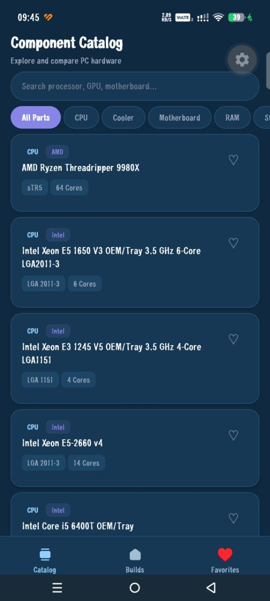

# PCForge Mobile App


> A local-first mobile app for discovering PC components and planning custom builds. Built with React Native, Expo Router, Zustand, and TypeScript.

---

## Project Information

| Field | Value |
| --- | --- |
| Status | Classroom-Ready & CI Verified |
| Platform | Android (Expo SDK 54+), iOS, Web |
| Language | TypeScript (Strict mode) |
| UI Architecture | Atomic Design (Atoms, Molecules, Organisms, UI) & Theme Tokens |
| State Management | Zustand with AsyncStorage Local-First Persistence |
| Repository | [GitHub](https://github.com/Isa-Bedoya-UdeA/PCForge-App) |

---

## Overview

PCForge Mobile helps users browse an extensive computer hardware catalog, assemble custom PC configurations, evaluate hardware compatibility (socket match, RAM memory standard, form factor clearances), and estimate real-time power consumption with safe PSU recommendations.

The core application works **completely offline for saved builds and favorites** using local device storage (`AsyncStorage`). When connected to the local network or internet, it consumes hardware data from the backend `pcforge-api`.

---

## Application Preview



---

## Tech Stack & Architecture

| Layer | Technology | Purpose |
| --- | --- | --- |
| **Language** | TypeScript (ES2022) | Full static type safety across domains, components, and stores |
| **Framework** | Expo (SDK 54+) & React Native 0.86 | Cross-platform native mobile runtime |
| **Navigation** | Expo Router (v54) | File-based routing (`/explore`, `/builds`, `/components/[id]`, `/favorites`) |
| **State** | Zustand (v5) | Reactive state stores (`useBuildStore`, `useFavoritesStore`) |
| **Persistence** | `@react-native-async-storage/async-storage` | Local on-device persistence resilient to corruption |
| **Networking** | Fetch API (`HttpClient`) | Typed client with 5000ms timeouts and structured error mappings |
| **Design System** | Atomic Design (`atoms`, `molecules`, `organisms`) | Reusable UI components styled with dark/light design tokens |
| **CI/CD** | GitHub Actions (`build.yml`) | Automated linting, typecheck, and unit/integration testing |

---

## Project Structure (Atomic Design)

```text
client/
├── .github/
│   └── workflows/
│       └── build.yml               # GitHub Actions CI workflow
├── src/
│   ├── app/                        # Expo Router screen routes
│   │   ├── _layout.tsx             # Root layout with theme and splash hydration
│   │   ├── index.tsx               # Redirect to /explore
│   │   ├── explore.tsx             # Catalog discovery, search & filtering
│   │   ├── favorites.tsx           # Favorited hardware parts
│   │   ├── builds/
│   │   │   ├── index.tsx           # Saved builds overview & actions
│   │   │   ├── create.tsx          # Build creation modal/form
│   │   │   └── [id].tsx            # Build detail, slots, compatibility & power
│   │   └── components/
│   │       ├── index.tsx           # Redirect to /explore
│   │       └── [id].tsx            # Hardware technical specifications detail
│   ├── components/                 # Atomic Design Component Catalog
│   │   ├── atoms/                  # ThemedText, ThemedView, LoadingSkeleton
│   │   ├── molecules/              # EmptyView, ErrorView, SpecRow, HintRow
│   │   ├── organisms/              # ComponentCard, SlotItem, CompatibilityBanner, PowerSummary
│   │   ├── ui/                     # Collapsible and layout helpers
│   │   ├── animated-icon.tsx       # Splash screen animation
│   │   └── app-tabs.tsx            # Bottom navigation bar
│   ├── constants/                  # Theme tokens, API config, category definitions
│   ├── services/                   # api.ts (HttpClient), components.service.ts, storage.service.ts
│   ├── stores/                     # build.store.ts, favorites.store.ts
│   ├── types/                      # Domain entities (Component, Build, Compatibility)
│   ├── utils/                      # compatibility.ts, power.ts (pure domain math)
│   └── tests/                      # Unit & integration test suites
│       ├── integration/            # components-service.test.ts
│       ├── mocks/                  # react-native mock
│       └── unit/                   # compatibility, power, build.store, favorites.store, storage
└── docs/                           # Comprehensive engineering documentation
```

---

## Getting Started

### Prerequisites

* **Node.js**: v20.x or v22.x LTS
* **pnpm**: v9.x or v10.x (`npm install -g pnpm`)
* **Expo Go App** (optional): Installed on your physical Android or iOS device from Google Play / App Store.

### 1. Installation

From the `client` folder:

```bash
pnpm install
```

---

### 2. Classroom & Physical Device LAN Demo Setup

To demonstrate the mobile app running on physical mobile devices during a live classroom presentation connecting to the local `pcforge-api`:

#### Step 1: Find Host Machine's Local IP

Open a terminal on the host computer running the API:

* **Windows**: Run `ipconfig` and find the **IPv4 Address** of your active Wi-Fi adapter (e.g., `192.168.1.85`).
* **macOS / Linux**: Run `ifconfig` or `ip a` (e.g., `192.168.1.85`).

#### Step 2: Configure Environment Variable

In `client/`, set your environment variable or update `.env`:

```bash
EXPO_PUBLIC_API_URL=http://<YOUR_LOCAL_IP>:3000
```

*(Example: `EXPO_PUBLIC_API_URL=http://192.168.1.85:3000`)*

> [!NOTE]
> Setting `EXPO_PUBLIC_API_URL` is completely **optional**! When opening the app through **Expo Go**, PCForge automatically detects your computer's local IP address from the Metro development server.
>
> [!TIP]
> If testing purely on the **Android Emulator**, Expo will automatically fallback to `http://10.0.2.2:3000`.

#### Step 3: Run the Backend API

In the `api/` directory:

```bash
pnpm dev
```

*(Verify it displays `API listening on http://0.0.0.0:3000`)*.

#### Step 4: Start the Mobile Application

In the `client/` directory:

```bash
pnpm start
```

* Press `a` to open in an attached Android Emulator.
* Press `w` to open in the Web Browser.
* Or **scan the generated QR Code** using the **Expo Go** app on your physical mobile phone connected to the **same Wi-Fi network**.

#### Step 5: Test Offline Resilience (Demo Flow)

1. In the app, browse components and favorite 2 items.
2. Create a new build named "Classroom Demo Rig" and assign a CPU, Motherboard, and RAM.
3. Observe live compatibility verification (Green/Amber) and power calculation.
4. **Turn OFF Wi-Fi** or disconnect mobile internet on the phone.
5. Notice that navigating to **My Builds** and **Favorites** still displays all saved configurations without crashes or data loss thanks to `AsyncStorage`.

---

## Quality Gates & Verification

All code adheres to strict linting, TypeScript typing, and automated testing gates:

```bash
# 1. Run ESLint static analysis
pnpm run lint

# 2. Run TypeScript strict type verification
pnpm run typecheck

# 3. Run Jest unit and integration test suite
pnpm test
```

---

## Continuous Integration (CI/CD)

The repository includes a GitHub Actions workflow located at [.github/workflows/build.yml](.github/workflows/build.yml). On every push or pull request to `main`, `master`, or `develop`, the workflow executes:

1. **Dependency Installation**: `pnpm install --frozen-lockfile`
2. **Linting**: `pnpm run lint`
3. **Typecheck**: `pnpm run typecheck`
4. **Automated Testing**: `pnpm test` (Unit and Integration suites)

No cloud secrets or external databases are required for the pipeline to pass.

---

## Documentation Index

| Document | Description |
| --- | --- |
| [CONSTITUTION.md](./docs/CONSTITUTION.md) | Non-negotiable architectural principles and technical boundaries. |
| [SPEC.md](./docs/SPEC.md) | Product and feature specifications. |
| [REQUIREMENTS.md](./docs/REQUIREMENTS.md) | Functional (FR-001–FR-023) and Non-Functional (NFR) requirements. |
| [PLAN.md](./docs/PLAN.md) | Technical implementation plan and milestones. |
| [TASKS.md](./docs/TASKS.md) | Structured task breakdown and verification traceability. |
| [ARCHITECTURE.md](./docs/ARCHITECTURE.md) | Complete system architecture, state flow, and storage patterns. |
| [DESIGNSYSTEM.md](./docs/DESIGNSYSTEM.md) | Color palettes, typography, spacing tokens, and component catalog. |
| [NAVIGATIONMAP.md](./docs/NAVIGATIONMAP.md) | Route map and user interaction flows. |
| [USERJOURNEY.md](./docs/USERJOURNEY.md) | Personas, user journeys, and UX wireframe specifications. |
| [SECURITY.md](./docs/SECURITY.md) | Security controls, input sanitization, and data protection policies. |

---

## Contributors

* **Isabela Bedoya Gaviria** — Software Engineering Student, Universidad de Antioquia
* **Rafael Aleman** — Software Engineering Student, Universidad de Antioquia
