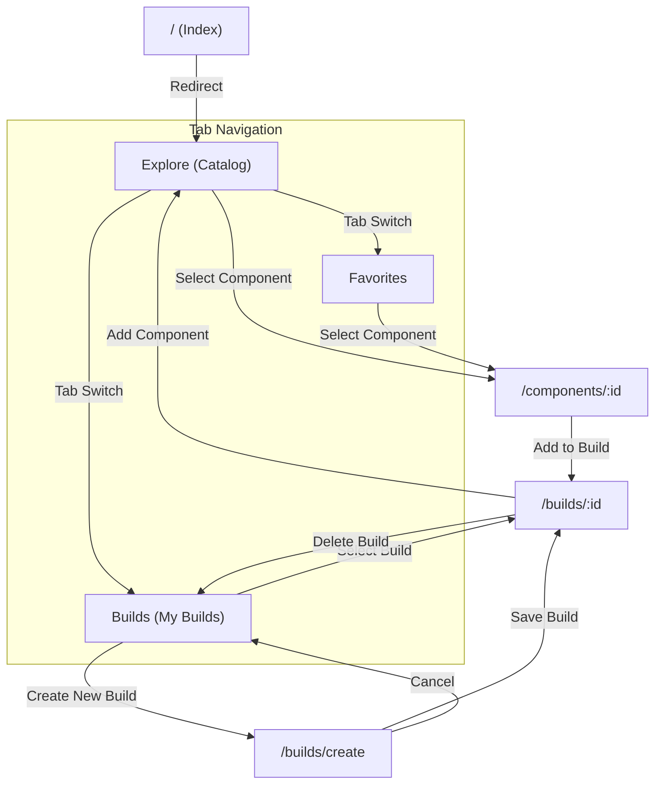

# Navigation Map

## Document Information

| Field | Value |
| --- | --- |
| Project | PCForge Mobile |
| Document | Navigation Map |
| Version | 0.1 |
| Status | Approved |
| Last Updated | 2026-10-06 |
| Platform | Cross-platform (Android / iOS / Web) |

## Related Documentation

* [CONSTITUTION](CONSTITUTION.md)
* [SPEC](SPEC.md)
* [REQUIREMENTS](REQUIREMENTS.md)
* [USERJOURNEY](USERJOURNEY.md)
* [ARCHITECTURE](ARCHITECTURE.md)
* [SECURITY](SECURITY.md)
* [DESIGNSYSTEM](DESIGNSYSTEM.md)

---

## 1. Purpose

This document governs the screen hierarchy, route structure, navigation flows, transitions, and deep linking rules for the PCForge Mobile React Native application.

The navigation system is implemented using **Expo Router**, providing file-based routing mapped directly to the `src/app/` directory.

## 2. Navigation Principles

* **Local-First Accessibility:** Core navigation destinations (Catalog, Builds, Favorites) require zero authentication and are immediately accessible upon launch.
* **Predictable Hierarchy:** Bottom tabs represent primary functional areas; stack views provide drill-down detail views; modal sheets handle creation and component selection.
* **Persistent Workspace:** Navigating between tabs preserves current scroll positions, filter states, and active build modifications in memory.
* **Safe Fallbacks:** Unmatched routes or missing resources gracefully redirect to friendly not-found views without application termination.
* **Deep Link Integrity:** Inbound route URLs map deterministically to component and build detail screens while validating parameter safety.

---

## 3. Navigation Structure

```text
Application Root
├── Tabs (Bottom Navigation)
│   ├── Explore / Catalog (/(tabs)/explore)
│   │   ├── Category Selector
│   │   ├── Component List
│   │   └── Search & Filter Controls
│   ├── Builds (/(tabs)/builds)
│   │   ├── Build List
│   │   └── Summary Metrics
│   └── Favorites (/(tabs)/favorites)
│       └── Favorite Component Grid
├── Stack Destinations (Drill-Down)
│   ├── Component Details (/components/[id])
│   ├── Build Details (/builds/[id])
│   └── Create Build Form (/builds/create)
└── System Fallback
    ├── Not Found Screen (+not-found)
    └── Error Boundary Fallback
```

---

## 4. Navigation Actors and Boundaries

| Actor / State | Accessible Destinations | Restricted Destinations | Notes |
| --- | --- | --- | --- |
| Guest / Local User | Explore, Component Details, Builds, Build Details, Create Build, Favorites | Cloud Sync Settings (Future) | Full access to all MVP catalog, build, and local persistence features |
| Authenticated User | All Guest destinations plus Cloud Sync and Profile (Future) | None | Stretch capability; authentication is optional and non-blocking |

---

## 5. Root Routes

| Route | Destination | Auth Required | Purpose |
| --- | --- | --- | --- |
| `/` | Index Redirect | No | Initial entry point; redirects immediately to `/(tabs)/explore` |
| `/explore` | Explore Tab | No | Primary catalog discovery screen with categories, search, and list |
| `/builds` | Builds Tab | No | List of saved user PC builds with power and compatibility summaries |
| `/favorites` | Favorites Tab | No | Collection of favorited hardware components |

---

## 6. Route Hierarchy and Deep Linking

### 6.1 Route Inventory

| Route Path | File Location | Presentation Type | Parameters |
| --- | --- | --- | --- |
| `/` | `src/app/index.tsx` | Redirect | None |
| `/(tabs)/explore` | `src/app/explore.tsx` | Bottom Tab | `category?: string`, `search?: string` |
| `/(tabs)/builds` | `src/app/builds/index.tsx` | Bottom Tab | None |
| `/(tabs)/favorites` | `src/app/favorites.tsx` | Bottom Tab | None |
| `/components/[id]` | `src/app/components/[id].tsx` | Stack Push | `id: string` (Required) |
| `/builds/create` | `src/app/builds/create.tsx` | Stack / Modal | None |
| `/builds/[id]` | `src/app/builds/[id].tsx` | Stack Push | `id: string` (Required) |
| `+not-found` | `src/app/+not-found.tsx` | Full Screen Modal | None |

### 6.2 Deep Linking Configuration

Deep linking is handled via Expo Linking with custom scheme `pcforge://`:

* `pcforge://components/cpu-ryzen-7800x3d` -> Routes directly to `/components/cpu-ryzen-7800x3d`.
* `pcforge://builds/gaming-rig-2026` -> Routes directly to `/builds/gaming-rig-2026`.
* Unrecognized link patterns fall back to `+not-found`.

---

## 7. Transitions and Navigation Flows



### 7.1 Flow: Browse and Inspect Component (UF-001, UF-002)

1. User opens `/explore`.
2. User selects category (e.g. CPU) and optionally types a search query.
3. User taps a component card -> navigates to `/components/[id]` via stack push transition.
4. User inspects specifications, toggles favorite, or taps Back to return to `/explore` with search state preserved.

### 7.2 Flow: Create and Configure Build (UF-004, UF-005, UF-007)

1. User opens `/builds`.
2. User taps "Create New Build" -> navigates to `/builds/create`.
3. User enters build name -> taps "Create" -> navigates to `/builds/[id]`.
4. User taps an empty slot (e.g. Motherboard) -> navigates to `/explore?category=MOTHERBOARD`.
5. User selects a motherboard -> adds to build -> returns to `/builds/[id]`.
6. Live compatibility banner and power metrics update dynamically on `/builds/[id]`.

### 7.3 Flow: Manage Favorites (UF-003)

1. User taps heart icon on any component card (in `/explore` or `/components/[id]`).
2. Component ID is added to `useFavoritesStore` and persisted in `AsyncStorage`.
3. User switches to `/favorites` tab -> sees favorited components in real-time.
4. Tapping a favorite card opens `/components/[id]`.

---

## 8. State and Navigation Lifecycle

* **Tab Preservation:** Switching tabs does not unmount sibling tab components; catalog search inputs and scroll offsets remain preserved.
* **Build Context Preservation:** When navigating from `/builds/[id]` to `/explore` to select a component, the active `buildId` is maintained in route parameters or store context so selection seamlessly returns to the active build.
* **Android Hardware Back Button:**
  * In detail screens (`/components/[id]`, `/builds/[id]`), pressing Back pops the stack.
  * In tab roots, pressing Back exits the app or returns to `/explore` per standard Android behavior.

---

## 9. Error and Fallback Routing

* **Missing Component ID:** If `/components/[id]` is requested with a non-existent ID, the screen displays `ErrorView` ("Component not found") with an action button navigating back to `/explore`.
* **Missing Build ID:** If `/builds/[id]` refers to a deleted build, user is redirected to `/builds` with a notification.
* **Undefined Routes:** Any unmapped route triggers `+not-found.tsx`, offering a "Go to Home" button targeting `/explore`.

---

## 10. Verification and Testing

| Test Area | Validation Strategy |
| --- | --- |
| Tab Switching | Unit/UI tests verify switching between Explore, Builds, and Favorites without unmounting state |
| Route Stack Navigation | Integration tests verify push to `/components/[id]` and pop back |
| Parameter Validation | Test invalid IDs (`../../` or script tags) are safely sanitized |
| Fallback Screen | Test navigating to `/unknown-path` renders Not Found screen |
| Deep Linking | Verify custom scheme `pcforge://components/[id]` opens detail view |
