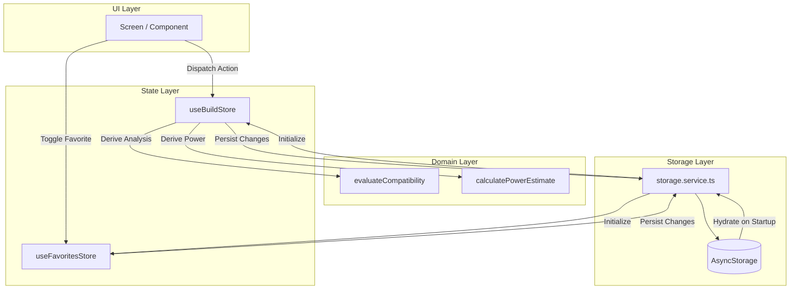

# PCForge Mobile — Technical Implementation Plan

| Field | Value |
| --- | --- |
| Project | PCForge Mobile |
| Document | Plan |
| Version | 0.1 |
| Status | Approved |
| Last Updated | 2026-10-06 |
| Specification Version | 0.1 |
| Requirements Version | 0.1 |
| Architecture Version | 0.1 |

## 1. Purpose

This technical implementation plan translates the approved PCForge Mobile product specification ([SPEC.md](SPEC.md)), testable requirements ([REQUIREMENTS.md](REQUIREMENTS.md)), and architectural boundaries ([ARCHITECTURE.md](ARCHITECTURE.md)) into an orderly, verified engineering sequence for the React Native/Expo client application.

The mobile application operates as a standalone client consuming the local-first `pcforge-api` catalog service. It runs in an independent repository, uses `pnpm`, and persists all builds and favorites locally without mandatory accounts, external databases, or cloud infrastructure.

## 2. Implementation Overview

Build a modular, feature-based React Native application using Expo SDK 57, TypeScript, Expo Router, React Native StyleSheet, and Zustand. The app consumes the PCForge API for catalog exploration, performs client-side hardware compatibility and power estimations via pure domain utilities, and persists user configurations in local `AsyncStorage`.

### 2.1 Goals

* Implement the complete catalog exploration experience: category browsing, debounced search, specification filtering, and detail inspection.
* Implement custom PC build management: creation, editing, renaming, deletion, single-item selection, and bounded multi-item collections (dual GPUs, RAM modules, storage drives, case fans).
* Implement deterministic compatibility analysis: socket matching, memory standard verification, form factor fit, GPU clearance, and honest reporting of missing specifications.
* Implement system power estimation: TDP aggregation, fixed 30% safety margin, and recommendation of the next commercial PSU wattage tier (e.g., 450 W × 1.30 = 585 W → 650 W).
* Implement local-first persistence: offline workspace restoration of saved builds and favorites via `AsyncStorage` without mandatory authentication.
* Provide comprehensive UI feedback states: loading skeletons, empty views, actionable error screens, and compatibility badges.
* Ensure educational maintainability and classroom reproducibility: fast startup, LAN access configuration to `http://<PC_LAN_IP>:3000`, and separate port allocation (Metro on 5562, API on 3000).
* Verify code quality through automated linting, typechecking, unit tests, and integration tests using `pnpm`.

### 2.2 Non-Goals

* Product pricing, retailer/Amazon integrations, shopping cart, checkout, or purchasing flows.
* Real-time collaboration, social feed, public build publishing, or cloud user profiles.
* Mandatory authentication, cloud synchronization, or external database setup on student machines.
* Moving compatibility or power calculation logic to the backend API.
* Direct access to raw OpenDB filesystem structures or backend server code from the client.

### 2.3 Requirement Coverage

| Requirement | Technical Approach |
| --- | --- |
| FR-001 | Retrieve canonical hardware categories from `GET /api/categories` and display interactive category grid/list. |
| FR-002, FR-003 | Query `GET /api/components` with category filtering and 1-based pagination; display responsive component lists with loading and empty states. |
| FR-004, FR-005 | Debounced text search and category-specific specification filters passed as query parameters to `GET /api/components`. |
| FR-006 | Fetch individual component specifications from `GET /api/components/:id` and display organized specification groups. |
| FR-007, FR-008 | Manage favorite component IDs in Zustand `useFavoritesStore` and persist them to `AsyncStorage`. |
| FR-009 to FR-013 | Manage builds in Zustand `useBuildStore` (create, rename, edit, list, delete) and persist to `AsyncStorage`. |
| FR-014 to FR-016 | Slot-based component assignment supporting single slots and multi-item collections (up to 2 GPUs, bounded RAM, storage, fans). |
| FR-017 to FR-019 | Pure domain utility `evaluateCompatibility` evaluating socket, memory standard, form factor, and clearances; report warnings and incomplete data honestly. |
| FR-020, FR-021 | Pure domain utility `calculatePowerEstimate` aggregating TDPs, applying 30% margin, and recommending the next standard commercial PSU capacity. |
| FR-022, FR-023 | Isolated persistence service `storage.service.ts` serializing and restoring builds and favorites from `AsyncStorage`. |
| FR-024 to FR-026 | Optional stretch features: isolated Firebase Authentication and Firestore synchronization kept decoupled from the MVP local core. |
| NFR-001 | Mobile responsive layouts using React Native `StyleSheet`, Flexbox, and safe area insets across Android phone sizes. |
| NFR-002 | Explicit UI states for loading indicators, empty placeholders, operational success, and user-friendly error banners. |
| NFR-003 | Local-first resilience: saved builds and favorites remain accessible even when the network/API is offline. |
| NFR-004 | Explicit API service abstraction (`components.service.ts` and `api.ts`) separating presentation from network transport. |
| NFR-005 | Modular structure separating presentation, state stores, services, types, and pure domain utilities for classroom clarity. |

---

## 3. Existing System Context

### 3.1 Current Structure

```text
client/
├── assets/
│   └── images/
├── docs/
│   ├── ARCHITECTURE.md
│   ├── CONSTITUTION.md
│   ├── NAVIGATIONMAP.md
│   ├── PLAN.md
│   ├── REQUIREMENTS.md
│   ├── SECURITY.md
│   ├── SPEC.md
│   ├── TASKS.md
│   └── USERJOURNEY.md
├── scripts/
│   └── reset-project.js
├── src/
│   ├── app/
│   │   ├── _layout.tsx
│   │   ├── explore.tsx
│   │   ├── favorites.tsx
│   │   ├── index.tsx
│   │   ├── builds/
│   │   │   ├── [id].tsx
│   │   │   ├── create.tsx
│   │   │   └── index.tsx
│   │   └── components/
│   │       ├── [id].tsx
│   │       └── index.tsx
│   ├── components/
│   │   ├── atoms/
│   │   │   ├── loading-skeleton.tsx
│   │   │   ├── themed-text.tsx
│   │   │   └── themed-view.tsx
│   │   ├── molecules/
│   │   │   ├── empty-view.tsx
│   │   │   ├── error-view.tsx
│   │   │   ├── hint-row.tsx
│   │   │   └── spec-row.tsx
│   │   ├── organisms/
│   │   │   ├── compatibility-banner.tsx
│   │   │   ├── component-card.tsx
│   │   │   ├── power-summary.tsx
│   │   │   └── slot-item.tsx
│   │   └── ui/
│   │       └── collapsible.tsx
│   ├── constants/
│   │   ├── categories.ts
│   │   └── theme.ts
│   ├── hooks/
│   │   ├── use-color-scheme.ts
│   │   └── use-theme.ts
│   ├── services/
│   │   ├── api.ts
│   │   ├── components.service.ts
│   │   └── storage.service.ts
│   ├── stores/
│   │   ├── build.store.ts
│   │   └── favorites.store.ts
│   ├── types/
│   │   ├── build.ts
│   │   ├── compatibility.ts
│   │   └── component.ts
│   ├── utils/
│   │   ├── compatibility.ts
│   │   └── power.ts
│   └── global.css
├── app.json
├── package.json
├── pnpm-lock.yaml
└── tsconfig.json
```

### 3.2 Existing Components to Reuse

* `src/constants/theme.ts`: Base color tokens, typography scales, spacing units, and inset constants.
* `src/hooks/use-theme.ts` & `src/hooks/use-color-scheme.ts`: Adaptive theme detection hook supporting light and dark modes.
* `src/components/themed-text.tsx` & `src/components/themed-view.tsx`: Themed typography and container primitives.
* `src/components/app-tabs.tsx`: Custom tab bar navigation layout and glass effects.
* `src/components/animated-icon.tsx`: Interactive SVG icon wrapper with reanimated transitions.

### 3.3 Components to Modify

* `src/app/_layout.tsx`: Expand root layout with global error boundary, status bar, and splash screen coordination.
* `src/app/index.tsx`: Configure root route redirecting to the primary `explore` (Catalog) tab.
* `src/app/explore.tsx`: Wire to `components.service.ts` for live category listing and component discovery.
* `src/app/favorites.tsx`: Connect to `useFavoritesStore` to display interactive list of saved components.
* `src/app/builds/index.tsx`, `[id].tsx`, `create.tsx`: Complete build management views with live compatibility and power widgets.
* `src/app/components/index.tsx` & `[id].tsx`: Implement paginated catalog browser and full specification viewer.

### 3.4 New Components (Atomic Design Hierarchy)

#### Atoms (`src/components/atoms/`)
* `loading-skeleton.tsx`: Placeholder loader for component cards and detail specs.
* `themed-text.tsx`: Typography wrapper with tokenized variants.
* `themed-view.tsx`: Container primitive responding to active theme.

#### Molecules (`src/components/molecules/`)
* `error-view.tsx`: Reusable error display with retry action for network failures.
* `empty-view.tsx`: Safe visual state when lists, searches, or favorites have zero items.
* `spec-row.tsx`: Key-value specification pair renderer with formatted units.
* `hint-row.tsx`: Information row with title and code badge.

#### Organisms (`src/components/organisms/`)
* `component-card.tsx`: Card rendering component image, name, manufacturer, and key specs.
* `compatibility-banner.tsx`: Visual alert card summarizing compatibility status (valid, warning, invalid).
* `power-summary.tsx`: Metric widget displaying estimated TDP, 30% margin, and recommended PSU tier.
* `slot-item.tsx`: Component slot row with add, replace, quantity controls, and remove actions.

---

## 4. Module and Package Structure

```text
src/
├── app/                        # Expo Router screen routes (file-based navigation)
├── components/                 # Reusable UI primitives and shared presentation widgets
├── constants/                  # Category lists, standard PSU tiers, theme tokens
├── hooks/                      # Custom React hooks (theming, debounce, network)
├── services/                   # Data access boundaries (API client, storage adapter)
├── stores/                     # Reactive Zustand state stores (builds, favorites)
├── types/                      # Domain interfaces, DTOs, and compatibility models
└── utils/                      # Pure business logic (compatibility rules, power calculation)
```

### Module Responsibilities

| Module | Responsibility | Dependencies |
| --- | --- | --- |
| `src/types/` | Define data contracts: `NormalizedComponent`, `Build`, `CompatibilityIssue`, `PowerEstimate`. | None |
| `src/constants/` | Define canonical categories, PSU tiers (450W, 550W, 650W, 750W, 850W, 1000W, 1200W), and storage keys. | `src/types/` |
| `src/utils/` | Pure calculation logic for compatibility rules and power estimation formulas. | `src/types/`, `src/constants/` |
| `src/services/` | Network HTTP client (`api.ts`), catalog operations (`components.service.ts`), local persistence (`storage.service.ts`). | `src/types/`, `AsyncStorage` |
| `src/stores/` | Reactive state management for builds and favorites; coordinates local persistence hydration. | `src/types/`, `src/services/`, `zustand` |
| `src/hooks/` | Utility hooks for theming, debounced input, and asynchronous query handling. | `src/constants/`, `react` |
| `src/components/` | Visual components (cards, lists, banners, metric widgets, buttons, skeletons). | `react-native`, `src/constants/` |
| `src/app/` | Screen compositions mapped to Expo Router routes. | `src/components/`, `src/stores/`, `src/services/` |

---

## 5. Component Design

### 5.1 Compatibility Engine (`src/utils/compatibility.ts`)

#### Responsibility

Evaluates hardware interdependencies among all selected components in a build and produces an array of structured issues (`CompatibilityIssue`).

#### Inputs

* `build: Build` (containing CPU, Motherboard, RAM, GPU, Case, Cooler, Storage, PSU).

#### Outputs

* `CompatibilityReport`:
  * `status: 'COMPATIBLE' | 'WARNING' | 'INCOMPATIBLE'`
  * `issues: CompatibilityIssue[]` (code, severity, title, message, affectedCategories)

#### Dependencies

* `src/types/component.ts`, `src/types/compatibility.ts`, `src/types/build.ts`.

#### Rules Evaluated

1. **CPU & Motherboard Socket:** Checks `cpu.specifications.socket === motherboard.specifications.socket`.
2. **Motherboard & RAM Standard:** Checks `ram.specifications.memoryType === motherboard.specifications.memoryType` (e.g., DDR4, DDR5).
3. **Motherboard & Case Form Factor:** Verifies that case supported form factors include motherboard form factor (e.g., ATX, Micro-ATX, Mini-ITX).
4. **Cooler & CPU Socket:** Verifies cooler socket support matches CPU socket.
5. **GPU Length Clearance:** Verifies `gpu.specifications.lengthMm <= case.specifications.maxGpuLengthMm`.
6. **RAM Slot Capacity:** Checks that selected module count does not exceed motherboard RAM slots.
7. **Storage Interface:** Checks that selected storage drive interfaces (NVMe, SATA) have available slots on the motherboard.
8. **Incomplete Data Warning:** If a component is missing critical specifications (e.g., socket or dimensions), emits a `WARNING` stating that compatibility could not be verified completely, never assuming compatibility.

---

### 5.2 Power Estimator (`src/utils/power.ts`)

#### Responsibility

Calculates estimated peak system power draw, applies a 30% engineering safety margin, and recommends the next standard commercial PSU wattage.

#### Inputs

* `build: Build`.

#### Outputs

* `PowerEstimate`:
  * `estimatedWattage: number` (sum of component TDPs + base allowance for motherboard/fans)
  * `recommendedWattage: number` (commercial tier >= estimatedWattage × 1.30)
  * `hasIncompleteData: boolean` (true if any major power consumer lacks TDP data)
  * `breakdown: Record<string, number>` (wattage by component category)

#### Dependencies

* `src/constants/categories.ts`, `src/types/build.ts`.

#### Standard PSU Tiers

`[450, 500, 550, 600, 650, 700, 750, 850, 1000, 1200, 1500]` Watts.

---

### 5.3 Storage Service (`src/services/storage.service.ts`)

#### Responsibility

Isolates all reading and writing to `@react-native-async-storage/async-storage`.

#### Methods

* `loadBuilds(): Promise<Build[]>`
* `saveBuilds(builds: Build[]): Promise<void>`
* `loadFavorites(): Promise<string[]>`
* `saveFavorites(ids: string[]): Promise<void>`
* `clearAll(): Promise<void>`

#### Error Handling

Catches local storage read/write exceptions, logs diagnostic details internally, and returns safe fallback data (empty arrays) so application startup is never blocked.

---

### 5.4 Catalog API Service (`src/services/components.service.ts`)

#### Responsibility

Communicates with the backend HTTP service using standard Fetch API.

#### Methods

* `getCategories(): Promise<string[]>`
* `getComponents(params: ComponentQueryParams): Promise<PaginatedComponentsResponse>`
* `getComponentById(id: string): Promise<NormalizedComponent>`

#### Error Translation

Translates network drops, timeouts (5000ms), and 4xx/5xx HTTP errors into normalized application error objects with user-friendly messages.

---

## 6. Data Model

### 6.1 NormalizedComponent

```typescript
export interface NormalizedComponent {
  id: string;
  category: string;
  name: string;
  manufacturer: string | null;
  specifications: Record<string, unknown>;
}
```

### 6.2 Build

```typescript
export interface BuildComponentItem {
  component: NormalizedComponent;
  quantity: number;
}

export interface Build {
  id: string;
  name: string;
  description?: string;
  components: Record<string, BuildComponentItem[]>; // Keyed by category
  createdAt: string;
  updatedAt: string;
}
```

### 6.3 CompatibilityIssue

```typescript
export type IssueSeverity = 'ERROR' | 'WARNING' | 'INFO';

export interface CompatibilityIssue {
  id: string;
  severity: IssueSeverity;
  category: string;
  title: string;
  description: string;
}
```

---

## 7. Algorithms and Business Logic

### 7.1 PSU Wattage Recommendation Algorithm

```text
1. Set baseSystemTdp = 50 W (for motherboard chipset, storage controllers, fans).
2. For each component in build:
     If component has tdp / wattage in specifications:
       totalTdp += specificationValue * quantity
     Else:
       mark hasIncompleteData = true
3. calculatedTotal = baseSystemTdp + totalTdp
4. targetWithMargin = calculatedTotal * 1.30
5. recommendedPsu = commercialTiers.find(tier => tier >= targetWithMargin) ?? 1500
```

### 7.2 Multi-Item Category Limits

* **VIDEO_CARD (GPU):** Maximum 2 units.
* **MEMORY (RAM):** Maximum modules bounded by `motherboard.specifications.memorySlots` (default 4). All RAM modules must share the same component ID.
* **INTERNAL_HARD_DRIVE (Storage):** Maximum drives bounded by `motherboard.specifications.sataPorts + motherboard.specifications.m2Slots` (default 6).
* **CASE_FAN (Fans):** Maximum bounded by case mount positions (default 6).

---

## 8. Technical Decisions

### TD-001 — Expo SDK and File-Based Routing (ADR-001, ADR-003)

* **Decision:** Use Expo Router with file-based navigation in `src/app/`.
* **Rationale:** Reduces boilerplate, provides automatic deep linking, matches React 19 standards, and enables clear teaching demonstrations.

### TD-002 — State Management with Zustand (ADR-005)

* **Decision:** Use Zustand stores (`useBuildStore`, `useFavoritesStore`) for cross-screen state, keeping transient form state in local React `useState`.
* **Rationale:** Zero-boilerplate, lightweight, no Context API re-render cascades, testable outside the React component tree.

### TD-003 — Local-First Persistence via AsyncStorage (ADR-006)

* **Decision:** Use `@react-native-async-storage/async-storage` as the local authority.
* **Rationale:** Fully functional offline; students do not need database credentials or cloud configuration.

### TD-004 — Client-Side Compatibility and Power Estimation (ADR-007)

* **Decision:** Implement compatibility checking and power math in pure TypeScript utilities on the client.
* **Rationale:** Demonstrates domain modeling in mobile applications; enables immediate feedback during offline build configuration.

### TD-005 — Styling with React Native StyleSheet (ADR-004)

* **Decision:** Use native `StyleSheet.create` and centralized theme tokens (`src/constants/theme.ts`).
* **Rationale:** Native performance on Android/iOS, zero extra CSS preprocessor complexity, cross-platform compatibility.

### TD-006 — Independent Repository Boundary (ADR-009)

* **Decision:** Keep `client` and `api` completely separate without a root npm/pnpm workspace monorepo.
* **Rationale:** Allows students to run the mobile app pointing to a remote or local instructor API instance without repository entanglement.

---

## 9. API / Interface Contracts

The mobile app connects to the PCForge API endpoints:

```text
GET /api/health
  Response: { status: "ok", service: "pcforge-api", version: "1.0.0" }

GET /api/categories
  Response: { data: string[], total: number }

GET /api/components?category=:category&search=:search&page=:page&pageSize=:pageSize
  Response: {
    data: NormalizedComponent[],
    pagination: { page: number, pageSize: number, total: number, totalPages: number }
  }

GET /api/components/:id
  Response: { data: NormalizedComponent }
```

---

## 10. CLI Contract

Verified package scripts in `client/package.json`:

* `pnpm start`: Start Expo development server (default Metro port `5562`).
* `pnpm android`: Run app on connected Android emulator or physical device.
* `pnpm ios`: Run app on iOS simulator.
* `pnpm web`: Run app in local web browser for quick visual prototyping.
* `pnpm lint`: Run ESLint and Expo static checks.
* `pnpm typecheck`: Run `tsc --noEmit` to verify type safety.
* `pnpm test`: Run unit tests for compatibility, power, and stores.

---

## 11. State Management



---

## 12. Error Handling

* **Network Failures:** Show `ErrorView` with retry button; preserve previously cached or local workspace state.
* **Corrupted Local Storage:** Detect JSON parsing failure, reset to safe empty array, and avoid crash.
* **Missing Specifications:** Display `WARNING` badge in build analysis stating that compatibility cannot be guaranteed due to missing data.

---

## 13. Concurrency and Asynchronous Work

* **Debounced Search:** User typing in catalog search input is debounced by 300ms before triggering API requests to avoid request thrashing.
* **Storage Serialization:** Build persistence writes are serialized to prevent concurrent race conditions during rapid component additions.

---

## 14. Caching

* **Memory Cache:** Catalog categories and viewed components cached in memory for the duration of the app session.
* **Offline Persistence:** All builds and favorite IDs persisted in `AsyncStorage`.

---

## 15. Security Implementation

* **No Hardcoded Secrets:** No API keys, credentials, or private tokens in mobile source code.
* **Transport Security:** HTTP/HTTPS requests configure reasonable timeouts (5000ms).
* **Input Sanitization:** Deep links and route parameters sanitized against malformed URI characters.
* **Safe Error Display:** Technical stack traces and internal exceptions are suppressed from UI displays.

---

## 16. Testing Strategy

* **Unit Tests (`test/unit/`):**
  * `compatibility.test.ts`: Verify CPU socket matching, RAM standard validation, GPU clearance, and missing data warnings.
  * `power.test.ts`: Verify formula `TDP × 1.30` and next commercial tier mapping (e.g., 450 W → 585 W → 650 W).
  * `build-store.test.ts`: Verify build creation, slot assignment, multi-item constraints, and deletion.
  * `storage.test.ts`: Verify serialization and hydration error handling.
* **Integration Tests (`test/integration/`):**
  * `api-service.test.ts`: Mocked Fetch tests verifying category retrieval, pagination parsing, and network error mapping.
* **Lint & Typecheck:**
  * ESLint and `tsc --noEmit` run before commits and in CI.

---

## 17. Migration / Data Changes

* **Storage Versioning:** Local storage keys include prefix `pcforge_v1_builds` and `pcforge_v1_favorites` to accommodate future data structure migrations gracefully.

---

## 18. Implementation Sequence

### Phase 0 — Scaffolding and Dependencies Baseline

* [x] Verify Expo SDK 57, React Native 0.86, React 19, and TypeScript configuration.
* [x] Verify pnpm dependencies: Zustand, AsyncStorage, React Native Safe Area Context, Vector Icons.

### Phase 1 — Domain Modeling, Pure Utilities, and Stores

* [ ] Define TypeScript models in `src/types/` (`component.ts`, `build.ts`, `compatibility.ts`).
* [ ] Implement pure compatibility engine in `src/utils/compatibility.ts`.
* [ ] Implement pure power estimation logic in `src/utils/power.ts`.
* [ ] Implement local persistence service in `src/services/storage.service.ts`.
* [ ] Implement Zustand stores: `useBuildStore` and `useFavoritesStore` with storage hydration.
* [ ] Write unit tests for compatibility, power, and stores.

### Phase 2 — Catalog API Integration and UI Primitives

* [ ] Implement HTTP client in `src/services/api.ts` and catalog operations in `src/services/components.service.ts`.
* [ ] Build reusable UI primitives: `LoadingSkeleton`, `ErrorView`, `EmptyView`, `ComponentCard`, `SpecRow`.
* [ ] Build analysis widgets: `CompatibilityBanner` and `PowerSummary`.

### Phase 3 — Screen Composition and Navigation Flows

* [ ] Configure root layout and tab navigation in `src/app/_layout.tsx` and `src/components/app-tabs.tsx`.
* [ ] Implement Catalog screen (`src/app/explore.tsx`) with category tabs, debounced search, and pagination.
* [ ] Implement Component Detail screen (`src/app/components/[id].tsx`).
* [ ] Implement Builds list screen (`src/app/builds/index.tsx`) and Create Build screen (`src/app/builds/create.tsx`).
* [ ] Implement Build Detail screen (`src/app/builds/[id].tsx`) with slot assignment, live compatibility, and power metrics.
* [ ] Implement Favorites screen (`src/app/favorites.tsx`).

### Phase 4 — Quality Verification, Documentation, and CI

* [ ] Implement comprehensive test suites in `test/`.
* [ ] Create GitHub Actions CI workflow in `.github/workflows/build.yml`.
* [ ] Verify local execution on Android emulator and physical device LAN access (`0.0.0.0:3000`).
* [ ] Complete `NAVIGATIONMAP.md`, `SECURITY.md`, `TASKS.md`, and update `README.md`.

---

## 19. Risks and Mitigations

| Risk | Impact | Probability | Mitigation |
| --- | --- | --- | --- |
| Incomplete specification data from catalog | False positive compatibility reports | High | Treat missing data as `WARNING` rather than compatible; mark incomplete analysis explicitly. |
| Network drop during classroom demo | Blank screen or unhandled rejection | Medium | Local-first design preserves saved builds and favorites; catalog features display clear error views. |
| Port collision between Metro and API | Service fails to start | Low | Pinned Metro port to 5562 and Express API port to 3000. |

---

## 20. Performance Considerations

* Use `FlatList` with `keyExtractor` and `initialNumToRender` for large component lists.
* Debounce catalog text search (300ms) to minimize network traffic.
* Avoid redundant compatibility recalculations by memoizing derived results.

---

## 21. Observability

* Standardized console logging with `[pcforge-mobile]` prefix in development mode.
* React error boundaries around top-level navigation routes to prevent white-screen crashes.

---

## 22. Documentation Changes

* Keep `SPEC.md`, `REQUIREMENTS.md`, `ARCHITECTURE.md`, `PLAN.md`, `TASKS.md`, `NAVIGATIONMAP.md`, and `SECURITY.md` in strict alignment.

---

## 23. Open Technical Decisions

* [RESOLVED: Port Allocation] — Metro on 5562, API on 3000 (ADR-009).
* [RESOLVED: Local Persistence] — AsyncStorage for MVP, Firebase kept optional stretch (ADR-006, ADR-008).
* [RESOLVED: PSU Margin] — Fixed 30% margin over estimated total TDP rounded to next commercial tier.

---

## 24. Definition of Done

* [ ] Every MVP requirement (FR-001 to FR-023, NFR-001 to NFR-005) is implemented and traceable.
* [ ] Pure domain logic (`compatibility.ts`, `power.ts`) is covered by unit tests.
* [ ] Local persistence functions reliably across app restarts without authentication.
* [ ] All quality checks (`pnpm lint`, `pnpm typecheck`, `pnpm test`) pass with zero errors.
* [ ] CI workflow runs on GitHub Actions without external service dependencies.
* [ ] Classroom setup steps documented in `README.md`.

---

## 25. Related Documentation

* [CONSTITUTION.md](CONSTITUTION.md)
* [SPEC.md](SPEC.md)
* [REQUIREMENTS.md](REQUIREMENTS.md)
* [ARCHITECTURE.md](ARCHITECTURE.md)
* [USERJOURNEY.md](USERJOURNEY.md)
* [NAVIGATIONMAP.md](NAVIGATIONMAP.md)
* [DESIGNSYSTEM.md](DESIGNSYSTEM.md)
* [SECURITY.md](SECURITY.md)
* [TASKS.md](TASKS.md)
