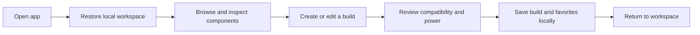
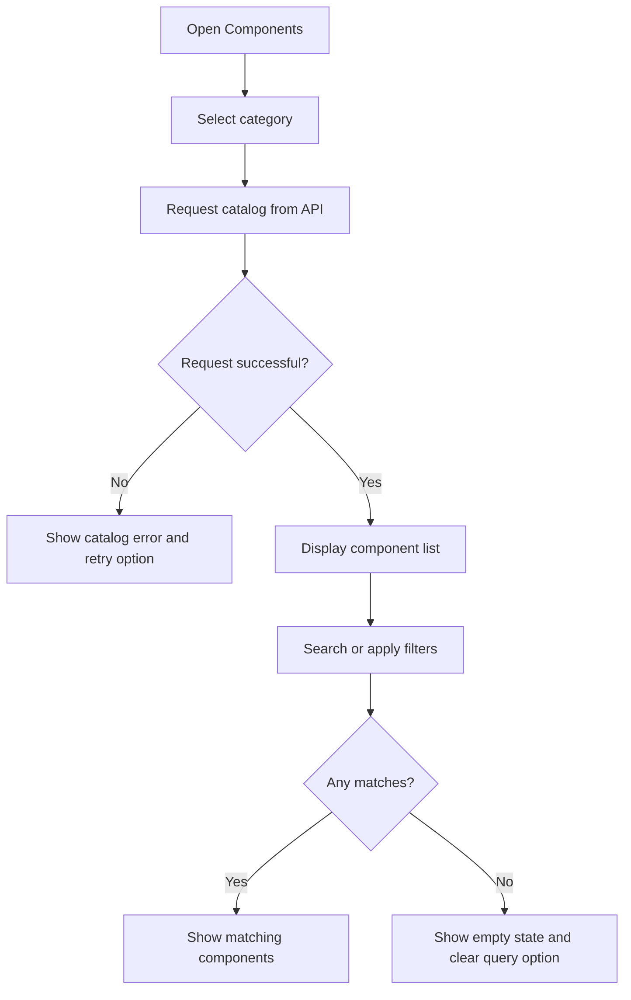
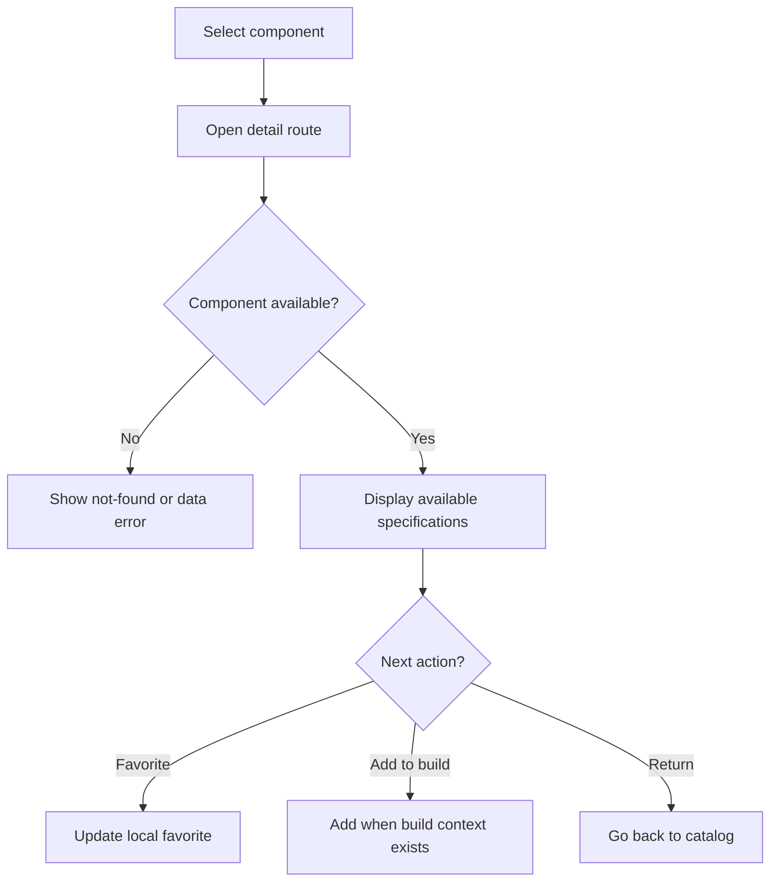
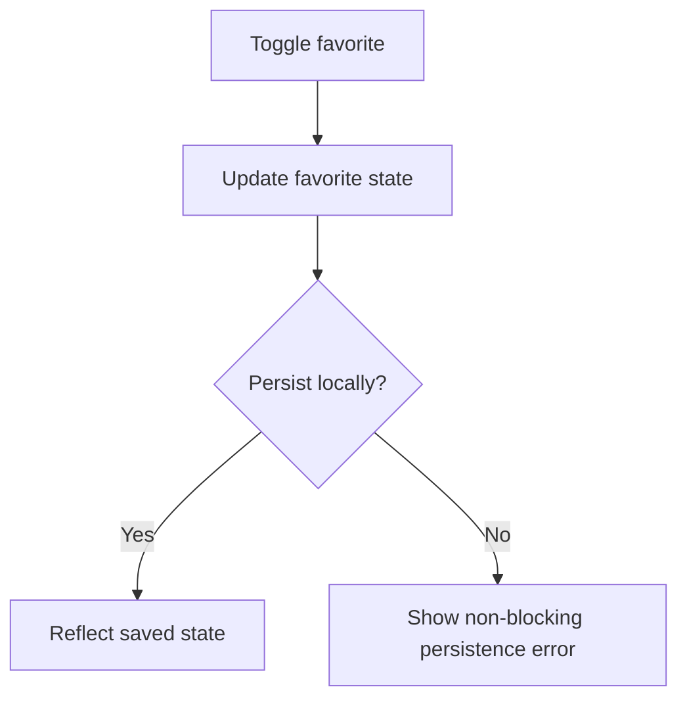
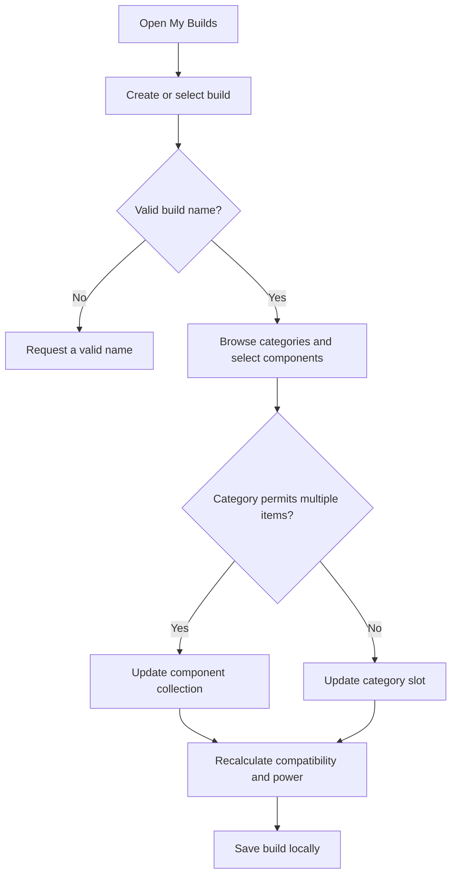
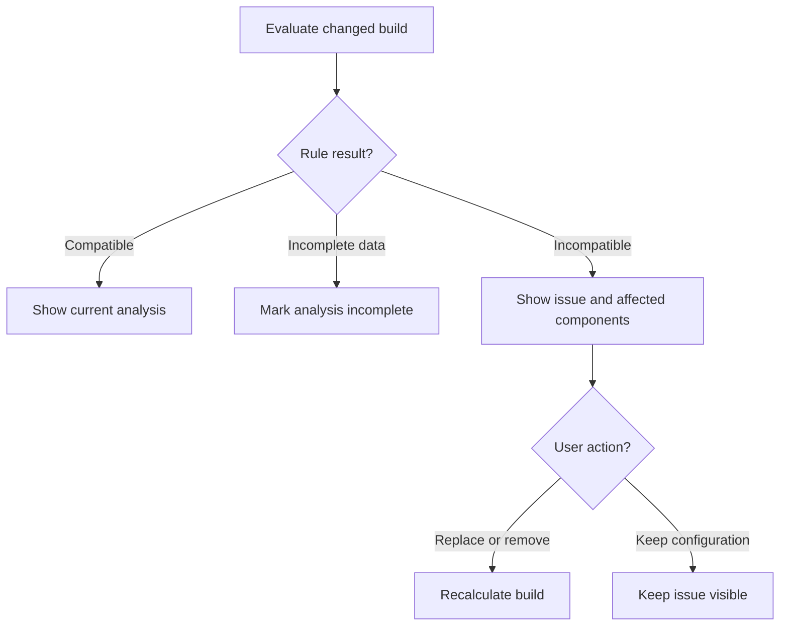
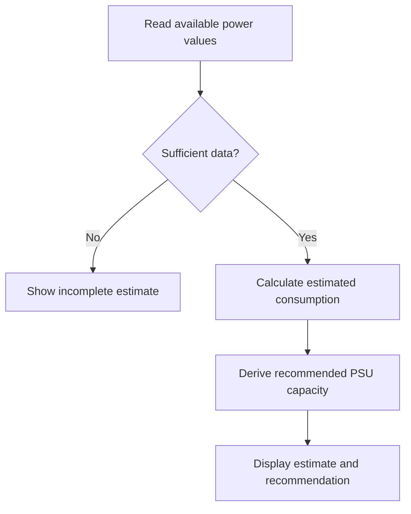
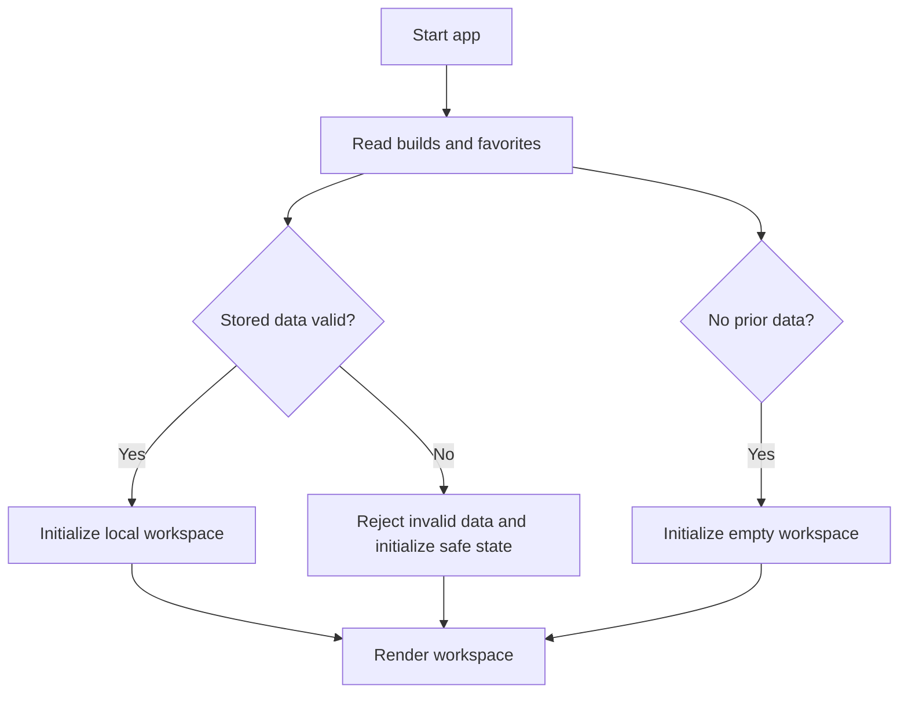
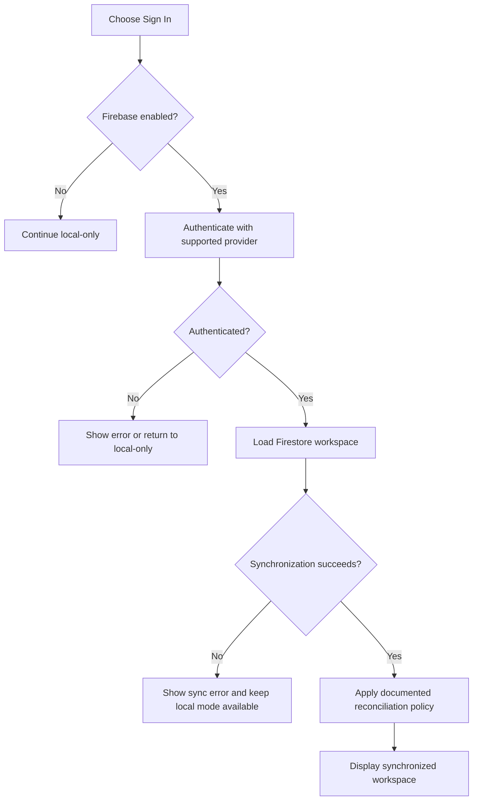

# User Journey

## 1. Purpose

Describe how PCForge Mobile users discover components, assemble and analyze PC builds, and retain their workspace locally. This document contains the detailed journeys and preserves the UF identifiers referenced by the product specification.

## 2. Primary Users

| User | Goals | Frustrations | Constraints |
| --- | --- | --- | --- |
| PC Builder | Create, validate, and save a custom PC build | Manually comparing hardware constraints; unclear compatibility or power risks | Catalog depends on the PCForge API; local workspace is the MVP authority |
| Hardware Explorer | Search, inspect, and favorite components | Missing specifications or difficulty finding relevant catalog items | Network is required for catalog retrieval; favorites are stored locally |
| Student / Learner | Understand a React Native app consuming an API and managing state | Excessive setup or infrastructure distracting from the class | Expo and TypeScript; demonstration should fit approximately 60 to 90 minutes |
| Registered User | Optionally access a synchronized workspace | Sign-in, network, or synchronization failures | Firebase is a stretch feature and must not block local use |

### User Assumptions

- The PCForge API is reachable when the user browses the catalog.
- Component data is normalized, though some source specifications may be unavailable.
- Compatibility and power results are derived locally from explicit rules and known data.
- Builds and favorites remain usable without authentication through local persistence.
- Firebase authentication and cloud synchronization may not be configured; if authentication is implemented, the intended provider is Google.
- The initial release targets Android and development through Expo.

## 3. Overall User Journey

## 4. Individual Journeys

### Journey 01 — First-Time Setup (UF-010 — Restore Local Workspace)

**Goal:** Start with a valid local workspace, including a safe empty state for a first-time user.  
**Trigger:** The user opens the application.  
**Preconditions:** The application is installed and local storage may or may not contain previous state.

#### 4.1.1 Steps

1. The application starts and reads persisted builds and favorites.
2. The application validates the stored structure.
3. The application initializes the relevant stores from valid data.
4. The application renders the workspace; a first-time user receives an empty workspace.

#### 4.1.2 Decision Points

- Is there persisted build data, favorite data, both, or neither?
- Does each stored collection match the expected structure?
- Can local storage be read?

#### 4.1.3 Success State

The user reaches a usable workspace with valid saved data or a safe empty state.

#### 4.1.4 Failure / Edge Cases

- No previous local data exists.
- Only builds or only favorites exist.
- Stored data is malformed and must be rejected safely.
- Local storage cannot be read; the app initializes a safe empty state and records the failure through its error mechanism.

#### 4.1.5 Exit State

The user can browse the catalog or continue working with locally stored builds and favorites.

### Journey 02 — Browse and Search Components (UF-001)

**Goal:** Find catalog components matching a category, search term, and supported filters.  
**Trigger:** The user opens the component catalog.  
**Preconditions:** The PCForge API is reachable and catalog data is available.

#### 4.2.1 Steps

1. The user opens Components and selects a category.
2. The application requests components from the API and displays the returned list.
3. The user enters a search term or selects supported filters.
4. The application updates the visible results.

#### 4.2.2 Decision Points

- Does the user change category before applying search or filters?
- Does the user clear the search term or all filters?
- Do any components match the current criteria?

#### 4.2.3 Success State

The user sees a component list matching the selected category, search, and filters.

#### 4.2.4 Failure / Edge Cases

- The API is unavailable or returns an invalid response.
- The API returns an empty result or no filter matches.
- The user clears search or filters and returns to the broader result set.

#### 4.2.5 Exit State

The user opens a component detail view, changes the query, or leaves the catalog.

### Journey 03 — View Component Details (UF-002)

**Goal:** Understand a component's available specifications before taking action.  
**Trigger:** The user selects a component from a list.  
**Preconditions:** The component is present in the API catalog.

#### 4.3.1 Steps

1. The user selects a component card.
2. The application opens the component detail route and displays normalized specifications.
3. The user may favorite the component or, when a build context exists, add it to the build.

#### 4.3.2 Decision Points

- Does the user return to the list without taking action?
- Does the user favorite the component?
- Is there a build context in which the component can be added?

#### 4.3.3 Success State

The user can inspect available specifications and take an available next action.

#### 4.3.4 Failure / Edge Cases

- The component cannot be retrieved.
- One or more source specifications are unavailable.

#### 4.3.5 Exit State

The user returns to the catalog, favorites the component, or returns to the builder after adding it.

### Journey 04 — Favorite a Component (UF-003)

**Goal:** Save or remove a component from the user's local favorites.  
**Trigger:** The user presses the favorite control.  
**Preconditions:** The component exists in the local catalog state.

#### 4.4.1 Steps

1. The user presses the favorite control.
2. The application updates favorite state and persists it locally.
3. The UI reflects the new favorite state.

#### 4.4.2 Decision Points

- Is the component currently favorited?
- Does local persistence succeed?

#### 4.4.3 Success State

The component is in the requested favorite state, which persists between sessions.

#### 4.4.4 Failure / Edge Cases

- Local persistence fails; the application presents a non-blocking error where possible.
- Pressing the control again removes the component from favorites.

#### 4.4.5 Exit State

The user continues browsing or views the locally stored Favorites collection.

### Journey 05 — Create a Build (UF-004)

**Goal:** Create and locally save a named PC configuration.  
**Trigger:** The user chooses to create a build.  
**Preconditions:** The application is running and the local workspace is available.

#### 4.5.1 Steps

1. The user opens My Builds, chooses Create Build, and enters a name.
2. The application creates an empty build.
3. The user selects a component category, searches or filters, and adds a component.
4. The application recalculates compatibility and power as components are added.
5. The user repeats for other categories and saves the build.

#### 4.5.2 Decision Points

- Is the build name valid and non-empty?
- Does the user leave the build empty or return to it later?
- Does a selected component conflict with the existing configuration?
- Is required data missing for a particular analysis rule?

#### 4.5.3 Success State

A named build is stored locally with its selected components and derived analysis results.

#### 4.5.4 Failure / Edge Cases

- The name is empty or whitespace-only and saving is prevented.
- A selected component conflicts with an existing component.
- A selected component lacks data required by an analysis rule.
- Local persistence fails.

#### 4.5.5 Exit State

The user reviews the saved build or returns to My Builds and continues later.

### Journey 06 — Edit a Build (UF-005)

**Goal:** Update a saved configuration while keeping its analysis current.  
**Trigger:** The user opens an existing build and chooses to edit it.  
**Preconditions:** The build exists in the local workspace.

#### 4.6.1 Steps

1. The user opens My Builds, selects a build, and enters edit mode.
2. The user may rename the build and may add, replace, or remove components.
3. The application recalculates compatibility and power after component changes.
4. The user saves the updated build.

#### 4.6.2 Decision Points

- Does the user rename the build or replace a component in the same category?
- Does the user leave without saving?
- Does the updated configuration contain compatibility issues?
- Can the component data be loaded?

#### 4.6.3 Success State

The selected build reflects the latest saved configuration and derived analysis.

#### 4.6.4 Failure / Edge Cases

- A component cannot be loaded.
- The updated build contains compatibility issues that remain visible.
- Persistence fails while saving.

#### 4.6.5 Exit State

The user returns to the saved build or leaves the edit flow without saving.

### Journey 07 — Delete a Build (UF-006)

**Goal:** Remove a saved build without affecting catalog components or favorites.  
**Trigger:** The user chooses Delete on a saved build.  
**Preconditions:** The build exists locally.

#### 4.7.1 Steps

1. The user opens a build and selects Delete.
2. The application requests confirmation.
3. The user confirms deletion.
4. The application removes the build from local persistence and returns to My Builds.

#### 4.7.2 Decision Points

- Does the user confirm or cancel deletion?
- Does local persistence succeed?

#### 4.7.3 Success State

The build no longer appears in the local workspace; its components remain in the catalog and favorites.

#### 4.7.4 Failure / Edge Cases

- The user cancels and the build remains unchanged.
- Local persistence fails while deleting.

#### 4.7.5 Exit State

The user remains in My Builds with the build removed or can retry after a persistence error.

### Journey 08 — Add Multiple Components (UF-007)

**Goal:** Represent collections of components in categories that permit multiple entries.  
**Trigger:** The user adds a component to a configured multi-item category.  
**Preconditions:** The selected category permits multiple entries.

#### 4.8.1 Steps

1. The user opens a multi-item category such as Storage, Memory, GPU, Case Fan, or Accessories.
2. The user selects Add and chooses a component.
3. The application appends the component and recalculates derived values.
4. The user may repeat, remove an entry, or add an identical component where permitted.

Memory count is limited by the motherboard's slot count and all selected modules must be the same component. Storage count is limited by supported motherboard connections; storage devices may differ. A build can contain at most two GPUs. Case fan count is limited by supported case mounting positions, with approximately ten as an upper bound only when supported.

#### 4.8.2 Decision Points

- Does the category allow multiple entries or duplicate components?
- Does the user remove one item from the collection?
- Does a quantity or category constraint permit the change?

#### 4.8.3 Success State

The build contains the requested component collection and updated derived analysis.

#### 4.8.4 Failure / Edge Cases

- A quantity or category constraint is violated.
- The added item creates a compatibility issue.
- Duplicate handling follows the category's configured rule.

#### 4.8.5 Exit State

The user continues editing the build with the collection updated or corrects the rejected change.

### Journey 09 — Resolve an Incompatibility (UF-008)

**Goal:** Understand and resolve a reported incompatibility, or keep it visible if unresolved.  
**Trigger:** The application detects an incompatible component relationship.  
**Preconditions:** At least two relevant components are selected and the corresponding rule is available.

#### 4.9.1 Steps

1. The application evaluates the build and displays an issue.
2. The user opens issue details and reviews affected components and the rule.
3. The user replaces or removes a conflicting component.
4. The application recalculates the build.

#### 4.9.2 Decision Points

- Does the user keep the configuration despite a warning?
- Does the user remove or replace the component responsible for the issue?
- Is there enough specification data to evaluate the rule?

#### 4.9.3 Success State

The issue is resolved, or remains explicitly visible as an unresolved condition.

#### 4.9.4 Failure / Edge Cases

- Required specification data is unavailable.
- Incomplete source data prevents the application from determining the rule result.
- The user chooses to keep the incompatible configuration.

#### 4.9.5 Exit State

The user returns to build editing with the updated analysis and any unresolved issue still visible.

### Journey 10 — Review Build Power Consumption (UF-009)

**Goal:** Understand estimated system power and the recommended PSU capacity.  
**Trigger:** The user opens build analysis or the build summary.  
**Preconditions:** The build exists and at least one selected component has power data.

#### 4.10.1 Steps

1. The application reads available component power values.
2. The application calculates estimated consumption.
3. The application applies a fixed 30% margin to estimated maximum consumption and rounds up to the next safer standard commercial PSU capacity.
4. The application displays the estimate and recommendation; the user can inspect the PSU relationship.

#### 4.10.2 Decision Points

- Is power data available for all relevant components?
- Does the user change a power-consuming component?
- Does the selected PSU satisfy the project's documented rule?

#### 4.10.3 Success State

The user sees a transparent estimate and a recommendation when sufficient data exists.

For example, an estimated maximum of 450 W becomes 585 W after the 30% margin and recommends 650 W rather than 600 W.

#### 4.10.4 Failure / Edge Cases

- Some components have unknown power consumption, so the estimate is marked incomplete.
- No power data is available, so no complete estimate can be shown.
- A changed component causes the estimate and recommendation to be recalculated.

#### 4.10.5 Exit State

The user returns to the build or changes components with the power analysis updated; the recommendation is not presented as manufacturer certification.

### Journey 11 — Sign In and Synchronize Workspace (UF-011, Optional)

**Goal:** Access a cloud workspace when optional Firebase features are enabled.  
**Trigger:** The user chooses Sign In.  
**Preconditions:** Firebase Authentication is enabled and the user has a supported OAuth provider.

#### 4.11.1 Steps

1. The user starts authentication and Firebase authenticates the user.
2. The application receives the authenticated identity.
3. The application loads the user's Firestore workspace.
4. The application reconciles or replaces local state according to the synchronization policy.
5. The application displays the synchronized workspace.

#### 4.11.2 Decision Points

- Does the user continue locally or sign in?
- Is authentication completed or cancelled?
- Does synchronization encounter conflicting local and cloud data?
- Does the user sign out and return to local-only behavior?

#### 4.11.3 Success State

The authenticated workspace is available on supported devices when cloud synchronization is enabled.

#### 4.11.4 Failure / Edge Cases

- Authentication is cancelled or fails.
- Firestore is unavailable.
- Synchronization detects conflicting data.

#### 4.11.5 Exit State

The user accesses the synchronized workspace, retries after an error, or continues with local-only functionality.

## 5. Core User Flows

### Flow 01 — Browse, Search, and Filter (UF-001)

### Flow 02 — Inspect Component (UF-002)

### Flow 03 — Manage Favorites (UF-003)

### Flow 04 — Create and Edit Builds (UF-004, UF-005, UF-007)

### Flow 05 — Resolve Compatibility Issues (UF-008)

### Flow 06 — Review Power Estimate (UF-009)

### Flow 07 — Restore Local Workspace (UF-010)

### Flow 08 — Optional Sign-In and Synchronization (UF-011)

## 6. Primary User Journey

### Rationale

Creating and validating a local build is the product's central outcome: it brings catalog discovery, component selection, compatibility analysis, power estimation, and persistence together without requiring an account.

### Steps

1. The user opens the app and restores or initializes the local workspace.
2. The user finds components in the API catalog and adds them to a named build.
3. The application recalculates compatibility and power, and the user resolves or reviews incomplete findings.
4. The user saves the build locally and returns to it later.

### Critical Moments

- Catalog failures must not make locally saved builds and favorites inaccessible.
- Missing specifications must be shown as incomplete analysis, not assumed compatibility.
- Incompatible selections remain editable and are never silently removed.
- Build and favorite changes must persist across application restarts.

### Friction / Risk

- API unavailability interrupts catalog browsing.
- Missing source data limits compatibility and power analysis.
- Local storage failures can prevent changes from surviving a restart.
- The optional cloud reconciliation policy is not yet defined.

### Dependencies

- A reachable PCForge API and normalized component catalog for discovery.
- Compatibility rules derived from the available catalog data and the fixed 30% PSU safety margin.
- AsyncStorage for local builds and favorites.
- Optional Firebase Authentication and Firestore configuration for cloud synchronization.

## 7. UX Principles Derived from the Journey

| Principle | Journey Evidence / Rationale |
| --- | --- |
| Keep the core local-first | Build and favorite journeys must work without mandatory authentication. |
| Show uncertainty honestly | Missing specifications make compatibility or power analysis incomplete, not successful. |
| Preserve user control | Incompatible builds remain editable and deletion requires confirmation. |
| Make derived results responsive | Build edits and multi-item changes trigger updated compatibility and power analysis. |
| Make recovery visible | Catalog, persistence, and synchronization failures need clear states and recovery paths. |
| Keep optional services optional | Firebase failures must not block local-only core functionality. |

## 8. Future UX Validation

### Open Assumptions

- The exact normalized BuildCores fields and supported compatibility rules depend on source-data inspection.
- Exact motherboard storage connection counts and case fan mounting positions depend on the selected catalog records.
- Local/cloud conflict reconciliation remains undecided; Firebase is optional and Google is the intended provider if implemented.
- The exact Android SDK and Expo SDK versions are not yet frozen.

### Research Questions

- Can a first-time user create and save a build without assistance?
- Do users understand the difference between incompatible, warning, and incomplete analysis?
- Can users recover from catalog failures while retaining access to their local workspace?
- Is the local/cloud distinction understandable when optional Firebase features are enabled?

### Validation Methods

- Usability testing
- Prototype testing
- Accessibility testing
- Analytics
- User interviews

### Success Metrics

| Metric | Purpose | Target / Baseline |
| --- | --- | --- |
| Build completion | Confirm the primary workflow is usable | A user creates and saves a build during the class |
| Analysis visibility | Confirm build changes update analysis | Every supported build change triggers updated analysis |
| Local persistence | Confirm workspace survives restart | Builds and favorites are available after restart |
| Catalog integration | Confirm API-backed discovery works | Component catalog data is loaded from the API |
| Local-mode independence | Confirm Firebase is not required | Core flows work without Firebase configuration |

## 9. Related Documentation

- `SPEC.md`
- `REQUIREMENTS.md`
- `NAVIGATIONMAP.md`
- `DESIGNSYSTEM.md`
